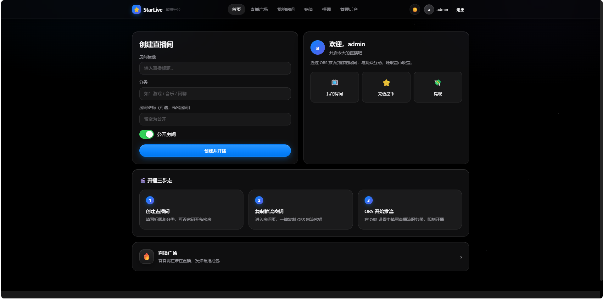
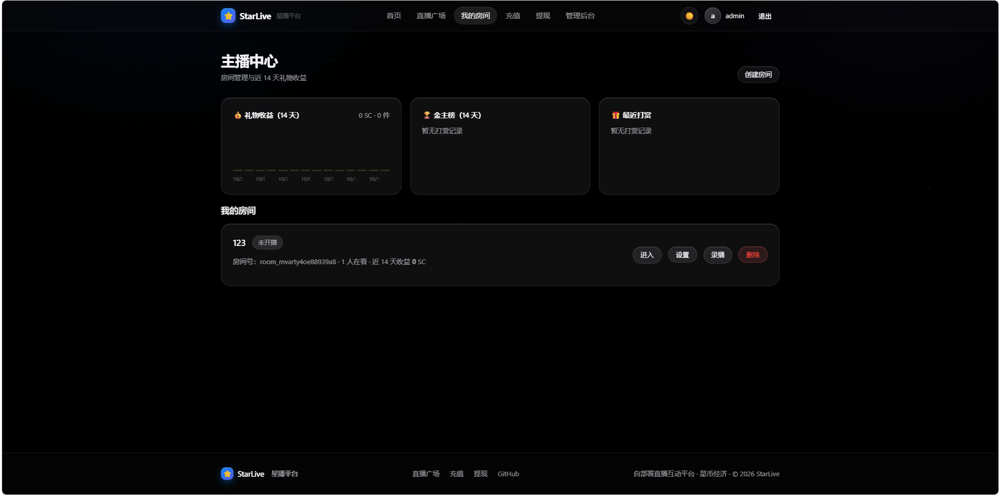
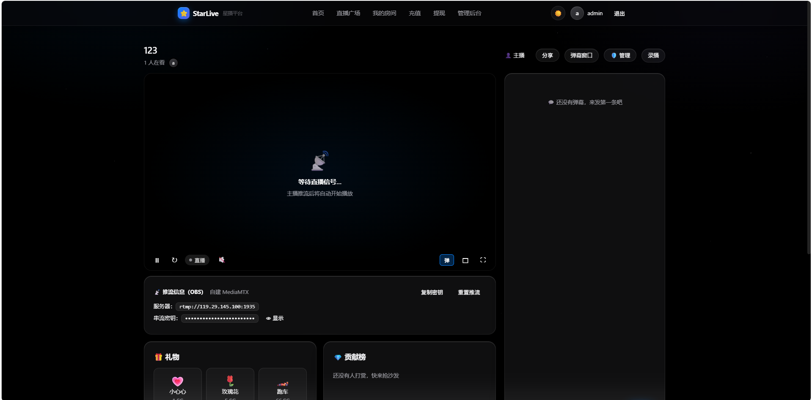
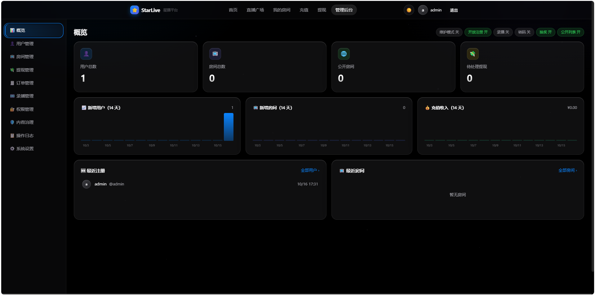
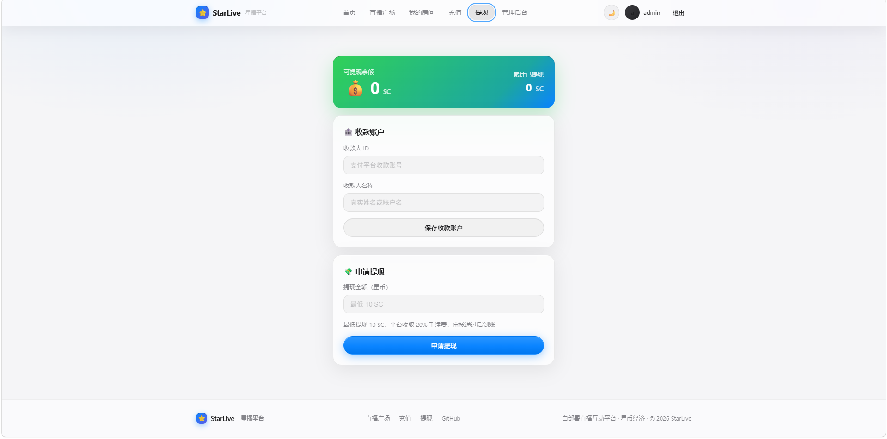

# sbc-starlive

> [鼠宝财](https://blog.mopush.cn) · 一键部署 [StarLive 星播](https://github.com/SMNETSTUDIO/StarLive) 自部署直播互动平台（VPS / 云服务器，Docker）

给 [StarLive（星播）](https://github.com/SMNETSTUDIO/StarLive) 配套的一键部署脚本：**一条命令**在干净的 Linux 服务器上把直播平台跑起来 —— 装 Docker、拉源码、生成配置、**自动打上 5 个必要补丁**、构建启动三个容器（服务端 / 推流 / 数据库），最后把「访问地址 + 要放行的端口 + 运维命令」打在屏幕上。

脚本不改上游业务代码，只在**配置与构建层**补上仓库里没接上的地方（详见 [脚本打的 5 个补丁](#脚本打的-5-个补丁)）—— 不打这些补丁，会出现「推流被拒」「HLS 404」「房间状态不动」这类问题。

[](LICENSE)


---

## 界面预览

| 首页（创建直播间 / 开播三步走） | 主播中心（礼物收益 / 我的房间） |
| --- | --- |
|  |  |
| **直播间**（播放器 / 弹幕 / OBS 推流信息） | **管理后台 · 概览**（功能开关 / 14 天趋势） |
|  |  |

| 提现（浅色主题） |
| --- |
|  |

---

## 目录

- [界面预览](#界面预览)
- [StarLive 是什么](#starlive-是什么)
- [这个脚本做什么](#这个脚本做什么)
- [环境要求](#环境要求)
- [快速开始](#快速开始)
- [装完做三件事](#装完做三件事)
- [推流与播放](#推流与播放)
- [脚本打的 5 个补丁](#脚本打的-5-个补丁)
- [执行流程](#执行流程)
- [部署后的目录结构](#部署后的目录结构)
- [常用运维命令](#常用运维命令)
- [升级](#升级)
- [数据备份与恢复](#数据备份与恢复)
- [常见问题](#常见问题)
- [安全建议](#安全建议)
- [其他部署方式（不走本脚本）](#其他部署方式不走本脚本)
- [卸载](#卸载)
- [合规与协议](#合规与协议)
- [License](#license)

---

## StarLive 是什么

一个**可以自己部署的直播平台**，带一套虚拟货币（星币）经济系统：观众充值、送礼物、发弹幕、抢红包、参与抽奖；主播通过礼物收益提现。

| 能力 | 说明 |
| --- | --- |
| 直播推流 | 自托管 **MediaMTX**（RTMP 入 + HLS 出，可选 WebRTC 低延迟）／云端 **Mux**，后台一键切换，存量房间沿用原 Provider |
| 实时互动 | **Socket.IO** 全房广播：弹幕、礼物特效、红包、抽奖、在线人数（presence 走 Redis ZSET 心跳） |
| 经济系统 | 星币充值（多支付网关）、提现（手续费 + 资金冻结）、交易流水 |
| 互动玩法 | 弹幕、礼物（按价值分级特效）、红包（随机/均分）、抽奖、在线心跳 |
| 治理 | 房管任命、房间禁言、操作日志、敏感词过滤（即时生效）、举报、审计日志 |
| 社交 | 关注主播、公开用户主页、直播间列表 |
| 管理后台 | 概览（14 天趋势）、用户/房间/提现/订单管理（CSV 导出）、RBAC、审计、内容治理、系统设置 |
| 录播 | 独立 FFmpeg Worker 转码落盘，**默认关闭**，可开关 |
| 技术栈 | Node 20 · NestJS 10 · TS · Socket.IO 4 · Redis · React 18 + Vite 5 + Tailwind + hls.js；`pnpm` workspaces monorepo |

一句话：**自部署版直播平台 + 星币经济**里做得相当完整的一个，Apache-2.0，允许商用。

## 这个脚本做什么

| 步骤 | 内容 |
| --- | --- |
| 1/9 检查依赖 | 校验 root、识别包管理器，缺 `curl / git / openssl / python3` 自动补装 |
| 2/9 安装 Docker | 已有则跳过；否则依次探测 **5 个软件源**（腾讯云内网 / 腾讯云公网 / 阿里云 / 中科大 / 官方）；**腾讯云机器自动写入镜像加速** + 容器日志大小限制 |
| 3/9 检查端口 | 检查 `3000`（网页/API/HLS）、`1935`（RTMP）、`8889`（WebRTC）；是自己容器占用则放行，方便重复执行 |
| 4/9 获取源码 | 浅克隆上游仓库；**直连 GitHub 被干扰时自动回退**到 `ghfast.top` / `gh-proxy.com` / `ghproxy.net`（每个源 90 秒超时），也可 `--git-proxy` 自定义 |
| 5/9 生成配置 | 写 `.env`：随机 `JWT_SECRET`（**重复执行会复用**）、`APP_BASE_URL`（自动探测公网 IP）、`COOKIE_SECURE`（`--url` 是 https 时自动置 true）、`NODE_ENV=production` |
| 6/9 打补丁 | 自动打 **5 个必要补丁 + 2 个附带补丁**，逐个打印处理结果，幂等可重复执行 |
| 7/9 构建启动 | `docker compose up -d --build`（首次约 2~5 分钟，之后有缓存约 20 秒）；`--recording` 会一并部署录播 Worker |
| 8/9 等健康检查 | 轮询 `/api/health`，就绪后打印返回值；`--admin-pass` 时自动创建管理员 |
| 9/9 汇总 | 打印访问地址、后台地址、管理员、OBS 推流地址、**要放行的端口**、安全提醒与常用命令 |

**实测**：Ubuntu 22.04.5 LTS / x86_64 / 2 vCPU / 1.9GB 内存，从零到平台可访问约 **2~3 分钟**（含编译，构建产物镜像 656MB）。运行起来三个容器合计约 **60MB 内存**（server 42MB + redis 9MB + mediamtx 10MB）。

**可重复执行**：脚本是幂等的 —— 已装过的机器再跑一次，会 `git reset` 到最新上游然后重新打补丁，`.env` 与 Redis 数据都保留（`JWT_SECRET` 不变，不会把在线用户踢下线）。

## 环境要求

| 项目 | 要求 |
| --- | --- |
| 系统 | Linux（需 systemd），Ubuntu 22.04 / Debian 12 已实测；CentOS 系用 yum/dnf 也可 |
| 权限 | root（或 `sudo`） |
| 内存 | 建议 ≥ 1GB（实测三容器约 60MB，构建时峰值约 500MB） |
| 磁盘 | ≥ 5GB 可用（镜像约 750MB，其余留给 Redis 数据与录播） |
| 架构 | `amd64` / `arm64` |
| 端口 | 默认 `3000`（网页/API/HLS）、`1935`（RTMP 推流）、`8889`（WebRTC，可选），需在云厂商**安全组放行** |
| 网络 | 能访问 Docker 软件源与镜像仓库；GitHub 直连不稳时脚本会自动换加速源 |

## 快速开始

```bash
# 下载后执行（推荐，脚本里 $0 是真实路径，末尾打印的运维命令可直接复制）
curl -fsSL -o /tmp/starlive.sh https://raw.githubusercontent.com/shubaocai/sbc-starlive/main/install_starlive.sh && sudo bash /tmp/starlive.sh
```

`raw.githubusercontent.com` 时通时不通的话，换 jsDelivr：

```bash
curl -fsSL -o /tmp/starlive.sh https://cdn.jsdelivr.net/gh/shubaocai/sbc-starlive@main/install_starlive.sh && sudo bash /tmp/starlive.sh
```

或者 clone 下来跑：

```bash
git clone https://github.com/shubaocai/sbc-starlive.git
cd sbc-starlive
sudo bash install_starlive.sh
```

常用参数：

```bash
# 指定对外地址（上域名后推荐）+ 自动建管理员
sudo bash install_starlive.sh --url https://live.example.com --admin-pass '你的密码'

# 换端口 + 同时部署录播/转码 Worker
sudo bash install_starlive.sh --port 8080 --recording

# 全部参数
sudo bash install_starlive.sh --help
```

| 参数 | 说明 |
| --- | --- |
| `--dir PATH` | 安装目录（默认 `/opt/starlive`） |
| `--port N` | 网页/API/HLS 端口（默认 `3000`） |
| `--rtmp-port N` | RTMP 推流端口（默认 `1935`） |
| `--webrtc-port N` | WebRTC 端口（默认 `8889`） |
| `--url URL` | 站点对外地址；`https://` 时自动 `COOKIE_SECURE=true`。默认自动探测公网 IP |
| `--git-proxy PFX` | GitHub 加速前缀，如 `--git-proxy https://ghfast.top/` |
| `--admin-user` / `--admin-pass` | 给了密码就自动建管理员（否则首次访问网页向导建） |
| `--recording` | 一并部署录播/转码 Worker（FFmpeg） |
| `--no-mirror` | 构建时不使用 npmmirror 国内源 |
| `--upgrade` | 拉取上游最新代码、重新打补丁并重建（`.env` 与数据保留） |
| `--uninstall` | 卸载（删容器、数据卷、镜像与安装目录），需 `--yes` 或交互确认 |

跑完屏幕上会把要用的信息列出来，重点在最后：

```
  ────────────────────────────────────────────────────────────
   StarLive 部署完成
  ────────────────────────────────────────────────────────────
    访问地址   http://<你的公网IP>:3000
    管理后台   http://<你的公网IP>:3000/admin
    管理员     admin / <你给的密码>
    OBS 推流   rtmp://<服务器IP>:1935    串流密钥 = 房间的 streamKey
    安装目录   /opt/starlive（compose 项目名 starlive）

    必须放行的端口：3000（网页/API/HLS）、1935（RTMP 推流），可选 8889（WebRTC）
    安全提醒
      · NODE_ENV=production，mock 支付网关默认关闭；正式收款请在后台配置真实网关
      · Redis 已改为只绑 127.0.0.1；数据全在卷 starlive_redis-data，请定期备份
      · 公网使用建议加一层 HTTPS 反代
```

## 装完做三件事

1. **放行端口**：安全组打开 `3000`（网页/API/HLS）与 `1935`（OBS 推流），WebRTC 可选 `8889`。不放行只有服务器本机能访问。
2. **建管理员**：用 `--admin-pass` 让脚本建，或访问 `http://<IP>:3000/` 走初始化向导（首次访问自动进向导）。
3. **配业务**：`/admin` → 系统设置里填站点地址、OAuth 登录、支付网关（易支付 / 支付宝 / 微信 / Stripe）、功能开关（维护模式、录播、转码、抽奖、直播广场）。

> 生产环境 `NODE_ENV=production` 时 **mock 支付网关默认关闭**，这是有意的 —— 别为了联调打开后忘了关。

## 推流与播放

| 用途 | 地址 / 填法 |
| --- | --- |
| OBS | 服务器 `rtmp://<IP>:1935`，串流密钥 = 房间的 `streamKey`（房间设置里可见，形如 `room_room_xxx_16hex`） |
| 网页播放 | `http://<IP>:3000/hls/<streamKey>/index.m3u8`（LL-HLS，0.2s 分片，前端用 hls.js） |
| 房间状态 | 开播时 MediaMTX 调 `/api/stream/hook` 把房间置 `active`；停播后后端轮询 MediaMTX API 回落 `idle` |
| 低延迟 | WebRTC 走 `8889`（需放行），HLS 不需要额外端口（经 3000 反代） |

## 脚本打的 5 个补丁

上游仓库的配置与代码之间有几处没接上，**不补就会出现功能性故障**。脚本会自动处理并打印每一项的结果：

| # | 文件 | 补什么 | 不打会怎样 |
| --- | --- | --- | --- |
| 1 | `infra/mediamtx.yml` | `api: no` → `api: yes` + `apiAddress: :9997` | 后端拿不到推流状态，房间状态不刷新 |
| 2 | `infra/mediamtx.yml` | 补 `authMethod: http` + `authHTTPAddress: http://server:3000/api/stream/hook` | 推流鉴权钩子不被调用，房间不会变 `active` |
| 3 | `infra/mediamtx.yml` | 补 `paths:` / `all_others:` | **推流直接被拒**：日志 `closed: path 'xxx' is not configured` |
| 4 | `infra/docker-compose.yml` | Redis 端口 `6379:6379` → `127.0.0.1:6379:6379` | 无密码 Redis 暴露在公网 |
| 5 | `apps/server/src/main.ts` | `/hls` 反代剥掉前缀 `req.originalUrl.replace(/^\/hls/, "")` | **HLS 一律 404**，浏览器播不了 |
| 附 | `apps/web/vite.config.ts` | `/hls` 开发代理补 `rewrite` | 开发模式同样 404 |
| 附 | `apps/server/Dockerfile`（+ worker） | 加 npmmirror 源 | 国内构建很慢 |

补丁是**幂等**的：重复执行不会重复追加（用脚本自己的注释做标记，而不是上游注释里已出现过的字符串）。

> 生效方式：改 `mediamtx.yml` 必须 `docker compose restart mediamtx`（MediaMTX 只在启动时读配置）；改 TS 要重新构建。脚本每次都会重建，所以不用担心。

## 执行流程

```
▸ 检查基础依赖        curl / git / openssl / python3，缺则按发行版补装
▸ 检查 Docker         没装则探测 5 个源安装；腾讯云机器自动写镜像加速
▸ 检查端口占用        3000 / 1935 / 8889，自己容器占用则复用
▸ 获取源码            git clone --depth 1（多源回退）；已存在则 fetch + reset
▸ 生成 .env           JWT_SECRET / APP_BASE_URL / COOKIE_SECURE / NODE_ENV / STREAM_PROVIDER
▸ 打补丁              7 项，逐条打印「替换 / 追加 / 已是目标状态」
▸ 构建并启动          docker compose -p starlive up -d --build（可选 --profile recording）
▸ 等待健康检查        轮询 /api/health（默认最多 90 秒）
▸ 创建管理员          给了 --admin-pass 且系统未初始化时执行
▸ 汇总                地址 / 端口 / 安全提醒 / 运维命令
```

## 部署后的目录结构

```
/opt/starlive/                      # 上游源码（脚本在安装时打补丁）
├── .env                            # JWT_SECRET / APP_BASE_URL / COOKIE_SECURE / NODE_ENV
├── apps/
│   ├── server/                     # NestJS 后端（容器内同时托管前端产物 + /api + /socket.io + /hls）
│   ├── web/                        # React 前端（构建产物由 server 托管）
│   └── worker/                     # 录播/转码 Worker（默认不启动）
├── packages/shared/                # 共享类型 / DTO / WS 事件 / Redis key
└── infra/
    ├── docker-compose.yml          # 已打补丁：Redis 仅本机、端口映射
    └── mediamtx.yml                # 已打补丁：API + 鉴权钩子 + all_others

Docker：
  容器  starlive-server-1（3000）· starlive-mediamtx-1（1935/8889）· starlive-redis-1（仅 127.0.0.1:6379）
  卷    starlive_redis-data（业务数据）· starlive_recordings-data（录播）
  网络  starlive_default
```

## 常用运维命令

```bash
cd /opt/starlive/infra

docker compose -p starlive ps                          # 状态
docker compose -p starlive logs -f server              # 日志（server / mediamtx / redis）
docker compose -p starlive restart mediamtx            # 改了 mediamtx.yml 后必须重启它
docker compose -p starlive up -d --build server        # 改了后端代码后重建
docker compose -p starlive --profile recording up -d   # 开启录播 Worker
docker compose -p starlive stop                        # 停服（数据保留）
```

## 升级

```bash
bash install_starlive.sh --upgrade      # 拉最新上游代码 → 重新打补丁 → 重建
```

`.env`（含 `JWT_SECRET`）与 Redis 数据都会保留；脚本打印的升级方式不需要手动 `git pull`。上游更新挺勤，建议升级前先备份数据。

## 数据备份与恢复

**业务数据全在 Redis 卷里**（AOF 已开），备份就是打包这个卷：

```bash
# 备份
docker run --rm -v starlive_redis-data:/d -v /root:/b alpine \
  tar czf /b/starlive-redis-$(date +%F).tar.gz -C /d .

# 恢复（会覆盖现有数据）
cd /opt/starlive/infra && docker compose -p starlive stop
docker run --rm -v starlive_redis-data:/d -v /root:/b alpine \
  sh -c 'rm -rf /d/* && tar xzf /b/starlive-redis-2026-10-16.tar.gz -C /d'
docker compose -p starlive start
```

也可以进容器用 `redis-cli SAVE` 后直接备份 `/data` 目录。录播文件在卷 `starlive_recordings-data`，按需单独备份。

## 常见问题

| 现象 | 原因 / 处理 |
| --- | --- |
| 浏览器打不开 | **最常见**：安全组没放行 `3000`。先在服务器上 `curl -s http://127.0.0.1:3000/api/health` 自测 |
| 推流报 `path is not configured` | 补丁 3 未生效。检查 `infra/mediamtx.yml` 末尾是否有 `paths:` / `all_others:`，然后 `docker compose -p starlive restart mediamtx`（`up -d` 不会因配置变更重建） |
| 播放地址 404 / 黑屏 | 补丁 5 未生效。检查 `apps/server/src/main.ts` 里 `path:` 那行是否含 `replace(/^\/hls/, "")`，然后 `up -d --build server` |
| 房间一直 `idle` | 补丁 1/2 未生效（MediaMTX API 或鉴权钩子），或 OBS 的串流密钥与房间不一致 |
| `git clone` 卡住／超时 | 国内直连 GitHub 常被干扰（现象：`curl github.com` 通、`git` 超时）。脚本会自动换加速源；也可 `--git-proxy https://ghfast.top/` |
| 健康检查超时 | `docker compose -p starlive logs --tail 100 server`；构建失败多见于网络或内存不足 |
| 首次访问进了初始化向导 | 正常：系统还没有管理员。用 `--admin-pass` 重跑，或在向导里建 |
| 充值时提示网关未配置 | 生产环境 mock 支付默认关闭，需在后台配置真实网关（易支付/支付宝/微信/Stripe） |
| 后台想删除用户 | 上游**没有删除用户接口**，只能封禁/禁言；真要删得动 Redis |
| 服务端能用但外网播放卡 | HLS 分发吃服务器上行带宽，这是资源问题而非配置问题；人多建议上 CDN 或切 Mux |

## 安全建议

- **上 HTTPS**：现在默认是 HTTP。有域名后用 `--url https://你的域名` 重跑（自动置 `COOKIE_SECURE=true`），前面加一层 Nginx/Caddy 反代。
- **限制来源**：管理后台是超管权限（能改系统设置、支付网关、提现审核），建议安全组只放行你的固定 IP，或后台加访问限制。
- **支付**：先在沙箱/mock 环境把充值回调、幂等入账、提现冻结走通，再上真网关；涉及资金的功能建议自己再审计一遍。
- **Redis**：脚本已把它绑到 `127.0.0.1`（上游默认 `6379:6379` 暴露且无密码），别改回去。
- **录播 Worker**：默认不启动；它跑 FFmpeg，会吃 CPU，按需开。

## 其他部署方式（不走本脚本）

上游仓库自带 compose，但要自己处理那 5 个补丁：

```bash
git clone --depth 1 https://github.com/SMNETSTUDIO/StarLive /opt/starlive
cd /opt/starlive && cp .env.example .env      # 至少填 JWT_SECRET（openssl rand -hex 32）
cd infra && docker compose up -d --build
```

不装 Docker 也可以只跑前端开发模式（`pnpm install && pnpm dev:web`），生产建议还是容器。

## 卸载

```bash
bash install_starlive.sh --uninstall --yes
```

会删除：容器与数据卷（**含全部业务数据**）、脚本构建出的镜像、`/opt/starlive`。共享基础镜像（`redis:7-alpine`、`bluenviron/mediamtx`）只在没有其它容器引用时才会删除。

## 合规与协议

- 上游 [StarLive](https://github.com/SMNETSTUDIO/StarLive) 采用 **Apache-2.0**，允许商用；本仓库**不重新分发上游代码**，脚本在安装时从上游仓库拉取源码，并只在你的服务器上修改配置与构建文件。
- 上游项目很新（2026-08 建仓），部分功能可能与文档描述有出入；涉及资金的功能（充值、提现、红包）上线前请自行测试与审计。
- 直播内容与虚拟货币的合规要求因地区而异（备案、内容审核、支付资质等），请自行确认当地法规。

## License

[MIT License](LICENSE) © 2026 鼠宝财
